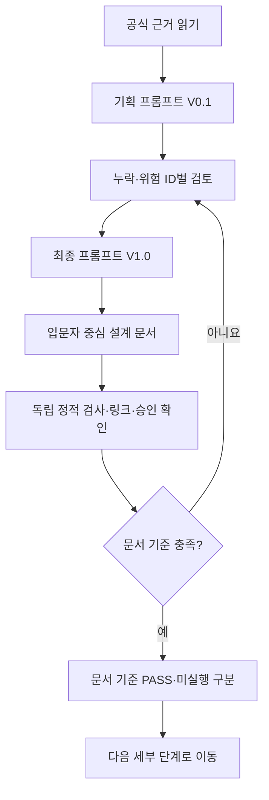
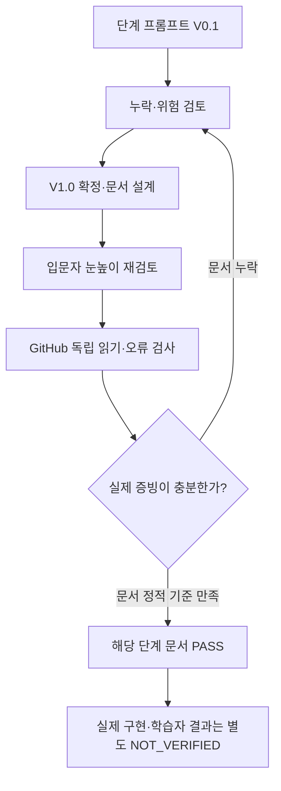

# Agent Codyssey — B1-1~B7-2 전 미션 공통 단계별 기획·설계·검증 필수 프로세스 V1.0

> **적용 범위:** 제2기 B1-1~B7-2 **총 15개 미션**의 각 정식 저장소 `training/round-04-agent/` 전 단계.
> **Owner 지시(2026-10-27):** 이 프로세스는 선택 권고가 아니라 **전 미션 필수 적용 규칙**입니다. 중앙 문서 및 각 미션의 `03-design/README.md`에서 직접 참조합니다.
> **승인 범위:** 규칙·문서 설계·검증 계획 반영에 한정. 개별 미션의 `04-src/` 신규 코드·실행·배포·병합·외부 연동은 **별도 명시적 승인** 이전에는 수행하지 않습니다. 문서만 만들고 미션 PASS/MASTER/CLEAR로 판정하지 않습니다.

## 처음 3분 — 처음 배우는 사람은 이대로 보세요

1. **00 시작:** 각 미션의 `training/round-04-agent/README.md`와 `03-design/README.md`를 엽니다.
2. **01 공식 요구:** 어떤 미션을 왜 해야 하는지, CORE/선택/금지 조건과 평가 근거를 구분합니다.
3. **02 이전 자료 확인:** 기존 코드·증빙은 **읽기 전용 참고**로만 활용하고 새 PASS로 옮기지 않습니다.
4. **03 설계 8단계:** **기획 프롬프트 V0.1 → 위험·누락 검토 → V1.0 → 입문자 설계 → 문서 정적 검증 → 다음 단계**를 하나씩 반복합니다.
5. **04 개발은 별도 승인:** 승인 전에는 설계·종이 예측만; 승인되면 신규 파일·시험·증빙·평가와 인계로 진행합니다.

## 1. B1-1~B7-2 15개 적용 대상과 책임

**대상 식별:** [중앙 공식 등록표](../training/round-04-agent/_registry/missions.yml)의 **15개 미션 ID/Repository 매핑을 유일한 등록 기준**으로 사용합니다. B1-1/B1-2, B2-1/B2-2, B3-1/B3-2, B4-1/B4-2, B5-1/B5-2, B6-1/B6-2/B6-3, B7-1/B7-2에 **동일한 프로세스**를 적용합니다.

- 공식 미션 PDF/평가/현재 ID가 최우선이며 **미션별 언어·CLI·웹·DB·AI·인프라 요구는 다를 수 있습니다.** B1-1 HTML/JavaScript 요구를 다른 미션에 강제하지 않습니다.
- 저장소 루트 및 이전 Round 01~03의 소스·브랜치·증빙·PASS는 **수정·복제·삭제하지 않습니다**.
- 중앙 레포는 기준·등록·총괄 검증, 개별 레포는 해당 미션의 문서와 후속 승인된 구현·시험·증빙을 담당합니다.
- 각 미션마다 `03-design/README.md` 첫 부분에서 이 중앙 표준과 단계별 계획을 보여줍니다. **상세 미션 문서 자체는 추후 단계별로 작성·검증하기 전까지 PLAN_ONLY**입니다.

## 2. 기존 전체 00~09 목차 유지

| 고정 단계 | 목적 | 해당 단계에서 만드는 결과·게이트 |
|---|---|---|
| **00** | 목표·학습지도·Quick Start·현재 승인·용어 | 30초 개요·복사하기 쉬운 명령 설명(실행 허가 있을 때)·진도 |
| **01** | 공식 미션 요구·평가·CORE/BONUS·제약 검토 | 요구 ID·평가 ID·근거 출처·불확실성 목록 |
| **02** | 현재 환경·이전 소스·부족한 요구 분석 | 읽기 전용 자산 목록·차이 표·사전 진단 설계 |
| **03** | 신규 구조·정보·동작·데이터·시험·교육 **8개 세부 설계** | 03-1~03-8 정적 검증 후에만 문서 설계 게이트 |
| **04** | 새 소스 구현 | **사용자 명시적 승인 후** 지정 `04-src/`에만 생성 |
| **05** | 실제 정적·런타임·오류·회귀·보안 시험 | 실행·입력·기대/실제·로그·코드 SHA |
| **06** | 실제 증빙·스크린샷·배포·재현성 검증 | 증빙 위치·날짜·환경·출처 SHA |
| **07** | 공식 평가·독립 학습자 설명/구현 평가 | E·LO·L1~L5·H1~H4·점수·사람의 검증 |
| **08** | 4종 슬라이드/학습 활동 산출물 | 실물 PPTX/PDF·화면 QA·근거와 코드 버전 |
| **09** | 전 단계 회귀 검증·최종 인계 | 재현 매뉴얼·미완료·문서/기능/학습 별도 게이트 |

**예외:** 아직 미션별 문서가 없는 경우 **계획만 기록하고 해당 단계는 NOT_STARTED**입니다. 선행 단계의 문서 PASS를 뒤 단계 실행 PASS로 승격하지 않습니다.

## 3. 모든 미션의 고정 03-1~03-8 하위 목차

| 번호 | 고정 목적 | 미션에 따라 세부 내용 적용 | 완료 전 확인할 내용 |
|---|---|---|---|
| **03-1** | 공식 요구·범위·수용 기준 | 공식 요구의 ID, CORE/BONUS, LO/E, 이슈 | 별도 MD 파일과 링크, 해당 미션 근거 |
| **03-2** | 정보·사용자 흐름·인터페이스 | 웹 IA/화면, CLI 명령, DB 사용 시나리오, 에이전트 흐름 등 | 목적지·입출력·시맨틱/오류·비밀 경계 |
| **03-3** | 파일 책임·모듈·환경·배치 구조 | 각 미션의 사용 기술·경로·의존관계·반응형(해당 시) | 소스 경로(미작성), 외부/내부 연결 계약 |
| **03-4** | 사건·상태·제어·데이터 처리 흐름 | UI 이벤트, CLI 상태, 작업/요청 수명주기 등 | 흐름도·상태표·실패·재시도·독립 상태 근거 |
| **03-5** | 데이터·입력·출력·보안·예외 | API/폼, 파일·SQL·인증·로그·LLM 안전 경계 등 | 정상·빈값·실패·오용·민감정보 보호 |
| **03-6** | 품질·접근성·시험·증빙 계획 | 화면·키보드(웹인 경우), CLI, DB, 보안·회귀·배포 등 | 시험 ID별 입력·기대·증거·PASS/FAIL·재검증 |
| **03-7** | 학습자 교육·사전사후 평가 설계 | 9요소·PRIMM·M01~M16·H1~H4·L1~L5 | 5분 첫 활동, 두 문장 설명·종이 재현·평가 계획 |
| **03-8** | 종합 설계 검증·04 인계 | 요구 전수·링크·중복·모순·승인·보존·미실시 구분 | **문서 설계 PASS의 근거**, 새 코드 승인과 분리 |

**파일 원칙:** 03-1~03-8은 각각 찾을 수 있는 **독립 MD 문서**를 두고 `03-design/README.md`에서 직접 링크합니다. 이미 기존 이름으로 독립 문서가 있는 경우(예: B1-1 03-7 `LEARNING-DESIGN.md`) **중복 파일을 만들지 않고 그 파일로 연결**합니다. 03-8은 종합 검증 문서가 독립적으로 존재해야 합니다. README는 전체 진도·Quick Start·목차·용어·현재 판정 중심으로 간결하게 유지합니다.

## 4. 매 세부 단계에서 반드시 반복할 7개 작업

1. **실제 읽기:** 공식 자료, 해당 미션의 HEAD/파일/이전 단계 PASS와 승인 상태를 확인합니다.
2. **V0.1 초안:** 역할·목표·입출력·공식 근거·금지 범위를 포함한 **기획 프롬프트 초안**을 작성합니다.
3. **누락·위험 검토:** 검토 항목에 `P01...`처럼 **추적 ID**를 붙이고 공식 요구 충돌·보안·교육 난도를 확인합니다.
4. **V1.0 보완:** 누락을 보완한 **최종 재사용 기획 프롬프트**를 확정합니다. 임의로 미션 기능·외부 서비스·플랫폼을 확대하지 않습니다.
5. **설계 작성:** 입문자가 **보이는 예상 결과 → 한글/영어/약어·비유 → Mermaid → 짧은 해설 코드/명령 → 오류 → 실습·정답** 순서로 배우도록 만듭니다. 코드 조각은 `EDUCATIONAL_EXAMPLE / NOT_EXECUTED`라고 표기합니다.
6. **독립 검증·오류 수정:** 정적 요구/문서 링크·앵커·Mermaid/코드펜스·자료 SHA·중복/모순·승인을 재조회하고 문제가 있으면 **같은 세부 단계에서** 수정·재검증합니다.
7. **PASS 및 인계:** **문서 범위 PASS/FAIL/NOT_VERIFIED**를 근거와 함께 기록합니다. 실제 기능·입문자 숙달·보안 실증은 별도 상태로 두고 다음 단계로 이동합니다.

## 5. 입문자용 공통 학습 구성·기술 이름

- 첫 화면: **10초/30초 요약, 3~5분 Quick Start, 단계별 파일 직접 링크, 현재 상태**.
- 용어: 처음은 **한글(English Full Name, 통용 약어)**; 없는 약어는 임의로 만들지 않습니다.
- 설명: 전문표보다 **완성 예상 모습/입력→처리→결과 그림**을 먼저 배치하고 긴 표·프롬프트·감사 기록은 후반 전문가 참고로 둡니다.
- 코드/명령: 한 번에 복사할 수 있는 **짧은 블록 + 한 줄씩 해설 + 전제조건/예상 결과/오류 대응**. 승인 전에는 명령을 실제 실행하지 않습니다.
- 예측·종이 실습·두 문장 자기 설명을 매 단계에 포함합니다. **답안과 힌트 H1~H4**, 독립 수행·학습자 평가를 구분합니다.
- 교육 9요소 K01~K09, 학습 방법 M01~M16, PRIMM, QG-01~08 및 숙달 L1~L5는 [기존 공통 학습 표준](LEARNER-CENTERED-AI-LEARNING-STANDARD.md)을 그대로 따릅니다.
- 4종 발표·학습·심화·복습 패키지는 기존 승인된 미션별 목표에 따릅니다. **실제 슬라이드 제작은 별도 단계**입니다.

## 6. 03-8 종합 검증 체크리스트

| 게이트 | 판정 근거 | 실패/미확인 처리 |
|---|---|---|
| 공식 요구 | 해당 미션 CORE 전체 ID가 설계·시험으로 추적됨 | 누락은 FAIL 또는 미확인; 공백을 숨기지 않음 |
| 문서 완전성 | 03-1~03-8 각각 독립 문서·README 링크, V0.1/V1.0/검토 이력 | 누락은 문서 게이트 NOT_VERIFIED/FAIL |
| 입문자 접근 | 한 개념 5분, Mermaid·짧은 예제·종이 재현·쉬운 용어 | 실제 초보자 시험 전 사용성 NOT_VERIFIED |
| 시험 계획 | 정상·오류·경계·회귀·보안 사례, 실제 입력·기대값·증거 양식 | 실제 시험 실행 전 RUN=NOT_VERIFIED |
| GitHub 무결성 | 실제 HEAD/상대 링크/앵커/블록·변경 파일·원본 SHA·승인 | 검증 뒤에만 문서 PASS |
| 04 개발 승인 | `owner_mission_development_approval` 실제 값 확인 | PENDING이면 **구현·실행 금지** |
| 최종 CLEAR | 코드·실행·공개 결과·독립 학습·평가·증빙 전수 | 계획/문서만으로 CLEAR 금지 |

## 7. 15개 미션의 적용·검증 상태 표시

- **표준 반영 PASS**: 이 중앙 문서·등록표 및 해당 미션 `03-design/README.md`에서 공통 프로세스 참조를 확인한 경우에만.
- **미션별 설계 PASS**: 해당 미션의 실제 03-1~03-8 산출물·추적표를 작성해 검증한 경우에만.
- **현재 B1-1**: 개별 설계 진행 결과를 해당 저장소 문서에서 확인합니다. 각 미션의 중앙 공통 표준 PASS가 다른 미션의 설계 PASS를 대신하지 않습니다.
- **다른 미션**: 아직 수행하지 않은 03 설계·04 구현·실행·학습자 숙달은 `PLAN_ONLY/NOT_STARTED/NOT_VERIFIED`를 유지합니다.
- **승인·보안**: 사용자 개인의 별도 승인 전 운영 변경·소스/브랜치 수정·명령 실행·배포·외부 서비스 접속 불가. 개인정보·토큰·비밀키를 문서에 넣지 않습니다.

## 8. 기록 필수 형식

| 기록 필드 | 기입 요령 |
|---|---|
| 미션 ID/레포/단계 | `B1-1 / repo / 03-4`처럼 구분 |
| 기준 문서·실제 HEAD | 공식 출처·Git 커밋 SHA·수정 파일 |
| V0.1→검토→V1.0 | 초안, 위험 ID, 보완 대응표 |
| 설계 산출물 | 별도 MD·Mermaid·설명용 코드·종이 실습·답 |
| 점검 | 링크 수·누락·코드 블록·중복·승인·원본 보존 |
| 결과 구분 | `DOC_GATE=PASS/FAIL/NOT_VERIFIED`; `RUNTIME=NOT_VERIFIED`; `LEARNER=NOT_VERIFIED`; `CLEAR=NOT_VERIFIED` |
| 후속 인계 | 다음 단계, 보류/장애, 사용자 승인 필요한 사항 |

**중앙 관리:** [Round 04 Agent 허브](../training/round-04-agent/README.md) · [15개 등록표](../training/round-04-agent/_registry/missions.yml) · [작업 경로 표준](ROUND-04-AGENT-WORKSPACE-STANDARD.md) · [학습 품질 표준](LEARNER-CENTERED-AI-LEARNING-STANDARD.md).
